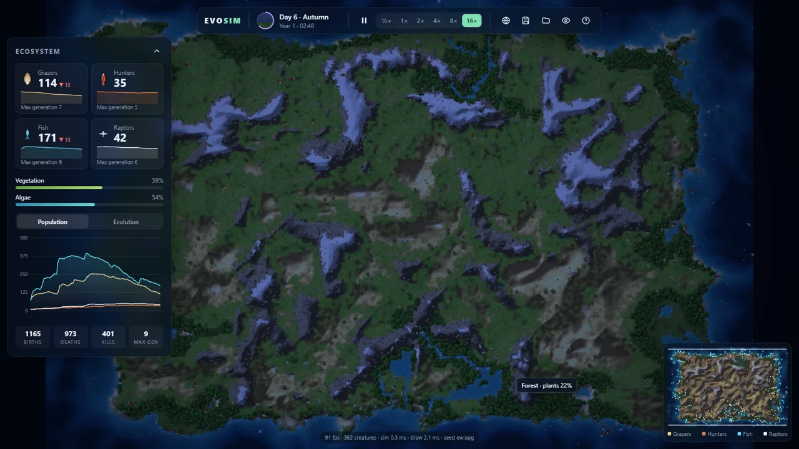
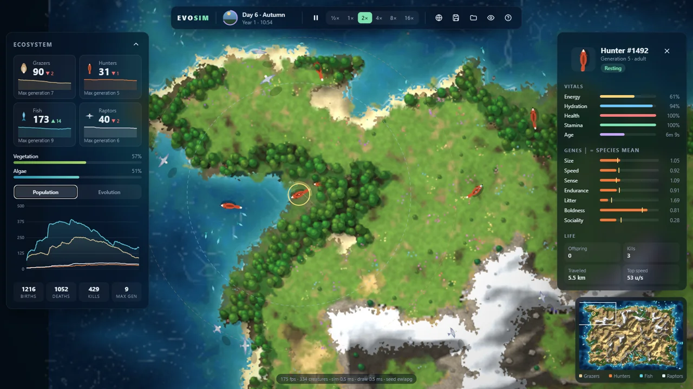
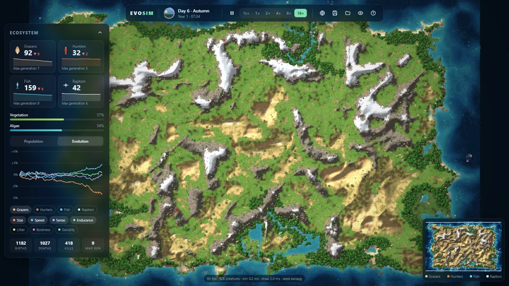

# Evosim

A living ecosystem in your browser. Grazers, hunters, fish and raptors share a procedurally generated continent, and every creature carries genes that are inherited, mixed and mutated. Nobody tunes the species. Natural selection does.



**[▶ Play it live](https://idiovoidi.github.io/Evosim/)**

▶ [Watch a short demo (webm)](docs/media/evosim-demo.webm)

## How it works

- **Four species.** Grazers eat vegetation, hunters stalk grazers, fish feed on algae, and raptors dive for fish and scavenge carrion.
- **Genes with costs.** Size, speed, senses, endurance, litter size, boldness and sociality all evolve. Big bodies need more food, fast legs burn energy and keen senses tax the brain.
- **Inheritance.** Offspring take a mix of both parents' genes plus small mutations, so successful traits slowly shift the population.
- **A world that pushes back.** Seasons change plant growth, nights hide prey and favour nocturnal hunters, and corpses fertilise the soil.

| Inspect any creature | Watch genes drift |
| --- | --- |
|  |  |

Click a creature to see its vitals, genes (compared with the species mean) and life stats. The **Evolution** tab charts how the average of each gene moves over time.

## Run it

```bash
npm install
npm run dev        # http://localhost:3000
npm run build      # production build in dist/
```

### Headless mode

The simulation has no browser dependency, so you can run it from the command line and print a population report:

```bash
npm run headless -- [simSeconds=1800] [seed=1] [reportEvery=60]
```

### Tests

```bash
npm test
```

## Controls

| Key | Action |
| --- | --- |
| `Space` | Pause / resume |
| `1`–`6` | Simulation speed |
| Drag / `WASD` | Pan the camera |
| Wheel / `+` `-` | Zoom |
| Click | Inspect a creature |
| Double-click / `F` | Follow the selected creature |
| `Esc` | Deselect / close |
| `N` | New world |
| `Ctrl+S` / `Ctrl+O` | Save / load |
| `V` | View options |
| `L` `G` `T` `R` | Lighting, vegetation, trails, rings |

## Built with

Vanilla JavaScript, Canvas and [Vite](https://vitejs.dev). Terrain uses seeded simplex noise, so a seed always reproduces the same world.

## License

MIT
